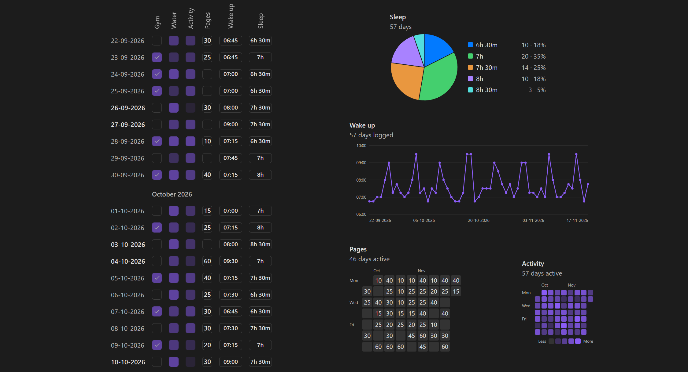
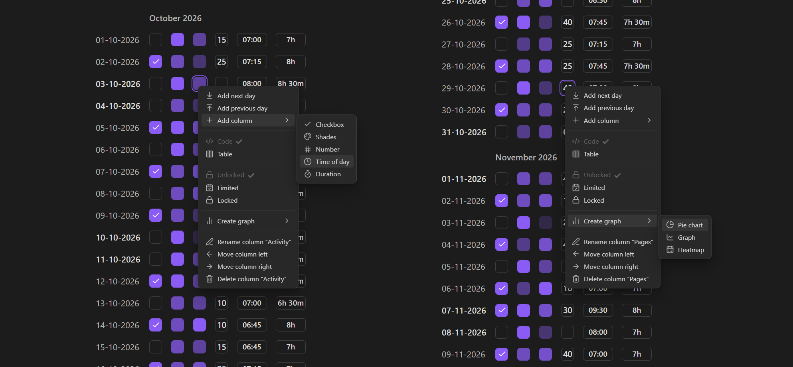
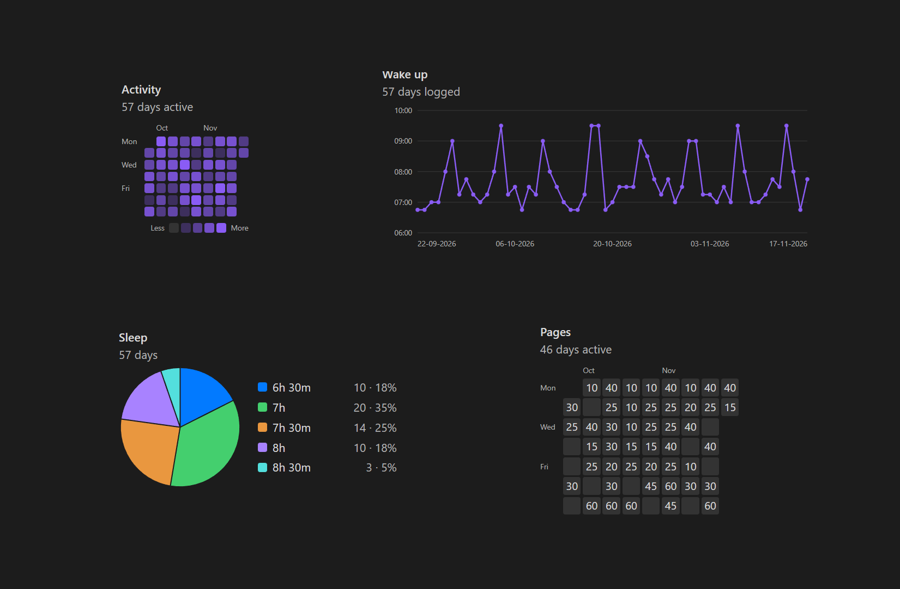
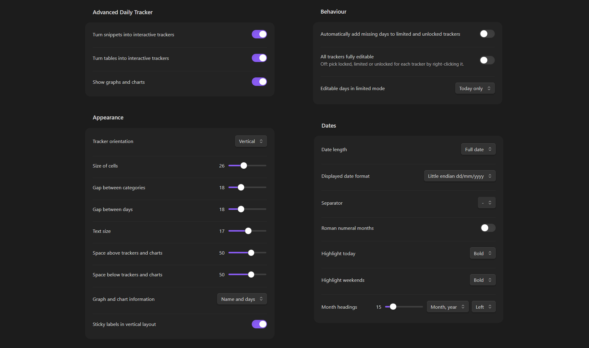

### Daily trackers that live in your notes

Check, shade or type in a cell. Everything is saved as plain text in your note.



### Everything is one right-click away

Add days and columns, rename or reorder them, and create charts for any column.



### Graphs, pie charts and heatmaps

Create a graph, pie chart or heatmap for any column. Charts update as you edit.



### Extensive options

Adjust layout, sizes, date format, highlights and more.



Highlights

* **Five column types:** checkboxes, shades, numbers, times of day and durations.
* **Two ways to write a tracker:** a `tracker` code block or a Markdown table.
* **Charts:** line graphs, pie charts and GitHub-style heatmaps, drawn from the trackers in a note (or from another note).
* **Lock modes:** unlocked, limited (only recent days) or locked, set per tracker.
* **Works out of the box.** No account or API key needed. Trackers show in Reading View, and everything stays plain text in your vault.

### Features

#### Column types

The header of a column decides how its cells behave:

| Header | Type | Stored as |
| --- | --- | --- |
| `Water` | Checkbox | `1` / `0` in a code block, ✅ / empty in a table |
| `Mood(5)` | Shades: 5 levels above empty (2 to 10) | `0` to `5` |
| `Pages(#)` | Number, 0 to 99 | the number |
| `Wake up(time)` | Time of day | `07:30` |
| `Sleep(dur)` | Duration | minutes, so `90` is 1h 30min |

* Click a shades cell to go one level up, wrapping back to empty. `Shift` + click goes down.
* Times accept `7:30`, `0730`, `7.30`, `7h30` or `7:30pm`. Durations accept `1h30`, `1:30`, `1.5h`, `45m` or a plain number of minutes.
* Cells can be used with the keyboard: `Tab` to a cell, then `Space` or `Enter`.

#### Right-click menu

* **Add next day**, **Add previous day** and **Fill to today**.
* **Add column** (or **row**, in horizontal layout) of any type, with the name typed right in the heading.
* Switch a tracker between **Code** and **Table** form.
* Choose the lock mode: **Unlocked**, **Limited** or **Locked**.
* **Create graph** for the column you clicked: pie chart, graph or heatmap, whichever fits its type.
* **Rename**, **move** and **delete** a column. You can also drag headings to reorder them.

#### Lock modes

* **Unlocked:** every day can be edited.
* **Limited:** only today (or today and yesterday, or the last 7 days, as you choose in the settings) can be edited.
* **Locked:** nothing can be edited, and the menu hides the editing options.

Turn on **All trackers fully editable** in the settings to ignore lock modes altogether.

#### Charts

Write one column name per line in a chart block. Names match with or without the type tag, so `Sleep` finds `Sleep(dur)`.

* **Graph:** a line for number, time and duration columns. Days without a value break the line instead of dropping to zero, and times wrap around midnight properly.
* **Pie chart:** works with every kind of column. Checkbox and shades columns show their levels, and number, time and duration columns get one slice for every different value, with no grouping.
* **Heatmap:** weeks as columns and weekdays as rows, for checkbox, shades and number columns.

To read a column from another note, add its link: `Sleep [[Health]]`. A line with only `[[Health]]` makes the lines after it read from that note.

#### Appearance

* Vertical or horizontal layout.
* Cell size, text size, gaps between days and categories, and space above and below.
* Month headings (none, gap, month, month and year) with left or centered alignment.
* Date length, order (dd/mm/yyyy, mm/dd/yyyy or yyyy-mm-dd), separator and Roman numeral months.
* Highlight today and weekends in bold, italic, underline or the accent color.
* Sticky labels that stay in view while you scroll.

#### Commands

* **Insert tracker**, **Insert graph**, **Insert heatmap** and **Insert pie chart** put a ready block at the cursor.
* A ribbon button in the left sidebar inserts a tracker too.

#### Usage

A tracker in a code block. The first header cell is the lock mode, the rest are your columns:

````markdown
```tracker
unlocked,Gym,Water(4),Mood(5),Pages(#),Wake up(time),Sleep(dur)
2026-11-16,1,3,4,20,07:30,450
2026-11-17,0,2,3,,07:45,420
```
````

The same thing as a table. Tables become trackers when the first header cell is `unlocked`, `limited` or `locked`:

```markdown
| unlocked | Gym | Water(4) |
| --- | --- | --- |
| 2026-11-16 | ✅ | 3 |
| 2026-11-17 |  | 2 |
```

Dates are always written as `YYYY-MM-DD` in the note. How they are shown is up to you in the settings.

Charts go in their own blocks:

````markdown
```tracker-graph
Sleep
Wake up
```

```tracker-pie
Water
```

```tracker-heatmap
Gym
```
````

Switch the note to Reading View to see everything drawn. All options are under **Settings → Advanced Daily Tracker**. You can turn code block trackers, table trackers and charts on or off separately, and when one is off its block is shown as plain text.

#### Network use and privacy

The plugin does not use the internet. It has no analytics or tracking, and your data never leaves your vault. Only the plugin's settings are stored in its data file.

If you sync your vault, you may want to keep different appearance settings on your phone and your computer. With Obsidian Sync, leave community plugin syncing off (the default). With Git, add `.obsidian/plugins/advanced-daily-tracker/data.json` to your `.gitignore`.

#### Support

Found a bug or have a suggestion? Email [contact@kgniewek.com](mailto:contact@kgniewek.com).

If you enjoy the plugin, you can [buy me a coffee](https://buymeacoffee.com/kgniewek).

#### License

Copyright (c) 2026 Krzysztof Gniewek (kgniewek). Licensed under the [PolyForm Strict License 1.0.0](LICENSE).

You can install and use the plugin for noncommercial purposes. The source is visible for transparency, but copying, redistributing or publishing modified versions, and commercial use, are not permitted.

Contributions are welcome. See [CONTRIBUTING.md](CONTRIBUTING.md).
